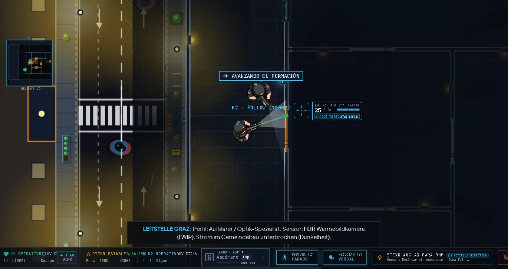
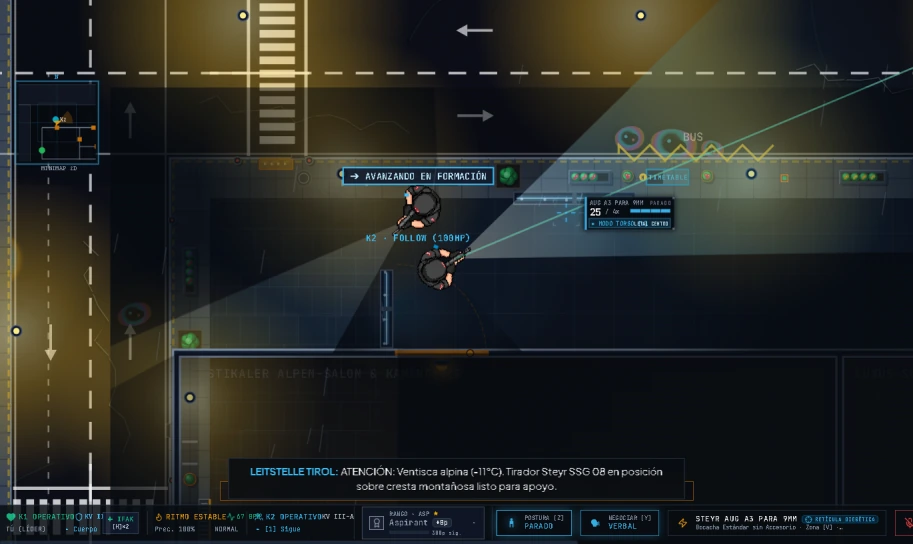
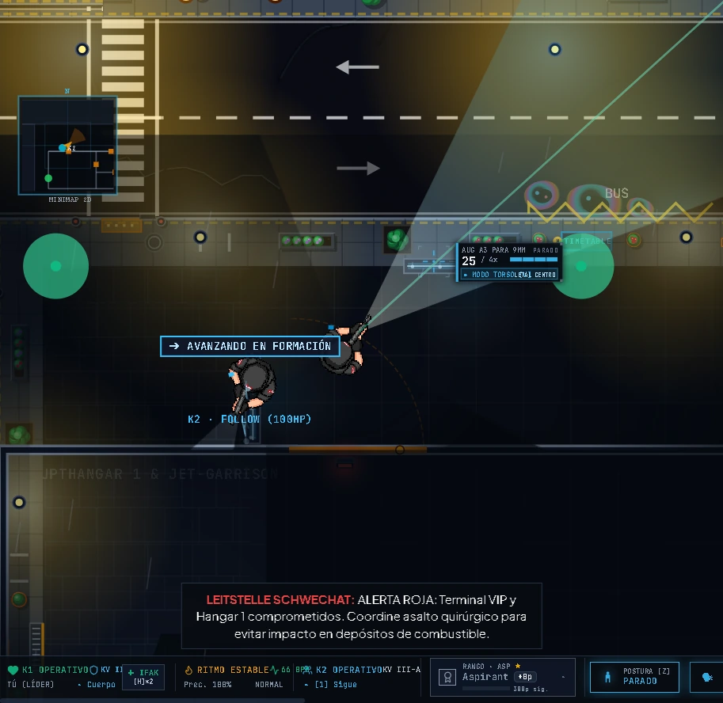
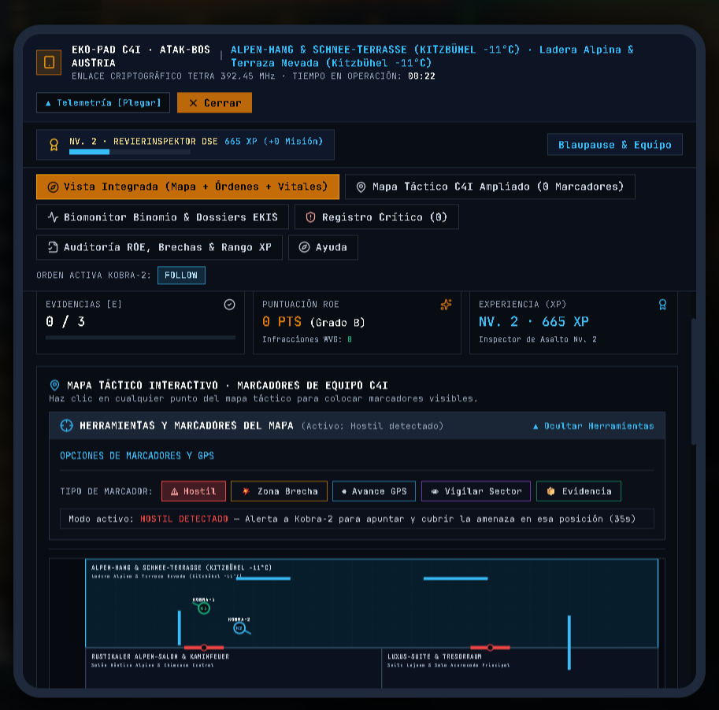

# EKO Cobra: Einsatzbefehl

[](https://github.com/earenbaz80/eko-cobra-einsatzbefehl/actions/workflows/ci.yml)

Simulador táctico policial en 2D cenital, escrito en TypeScript y renderizado con Canvas 2D. Diriges a un operador de la unidad antiterrorista austríaca **EKO Cobra** y a su binomio (Kobra-2) en intervenciones urbanas, con reglas de enfrentamiento, balística por zonas del cuerpo e identificación de objetivos antes de abrir fuego.



**[▶ Jugar en el navegador](https://earenbaz80.github.io/eko-cobra-einsatzbefehl/)** — no hace falta clonar ni instalar nada.

## Qué es

Una única página web que ejecuta un motor de juego propio sobre `<canvas>`. No hay servidor ni backend: toda la simulación corre en el navegador.

- **Motor táctico**: mapa, iluminación con linterna y conos de visión, sombras, partículas, clima (lluvia, nieve con huellas) y post-proceso.
- **Binomio con IA**: Kobra-2 sigue formaciones y recibe órdenes (seguir, cubrir, asegurar, suprimir, curar, reagrupar).
- **Balística por zonas**: impactos en torso, cabeza y extremidades, con dispersión por fatiga, lesiones en brazos, retroceso y tiempo de recarga.
- **Reglas de enfrentamiento**: disparar a un no combatiente o a un sospechoso ya rendido penaliza la puntuación y queda en el registro de la misión.
- **Equipo policial**: C4, ariete, patada de brecha, granadas CS, táser, IFAK/torniquete, linterna, cámara térmica FLIR con paletas y visión nocturna GPNVG-18.
- **HUD diegético**: minimapa 2D arrastrable, PiP de la bodycam de Kobra-2, retícula que sigue al cursor con lectura de munición y objetivo, radio de la central y panel EKO-Pad de planificación.
- **Audio procedural**: sintetizado con Web Audio (disparos, pasos, ambiente, lluvia) y órdenes por voz con Web Speech.

## Galería

**Misión 4 — Chalet Alpino (Tirol).** Ventisca alpina, nieve y un tirador atrincherado sobre la cresta.



**Misión 5 — Aeropuerto Wien-Schwechat.** Terminal VIP y hangar comprometidos: asalto quirúrgico sin dañar los depósitos de combustible.



**EKO-Pad C4I.** Planificación en pausa: mapa táctico con marcadores de equipo, dossieres EKIS, auditoría de ROE y progresión del operador.



## Controles

| Acción | Tecla |
|---|---|
| Moverse | `W` `A` `S` `D` |
| Correr (consume fatiga) | `Shift` |
| Apuntar | Ratón |
| Disparar | Clic izquierdo |
| Menú de órdenes contextual | Clic derecho |
| Grito policial / orden de rendición | `Espacio` |
| Interactuar (puertas, objetos) | `E` |
| Patada de brecha | `F` |
| Cargar C4 | `C` |
| Ariete | `X` |
| Inspeccionar | `Q` |
| Gadget (granada CS) | `G` |
| Táser | `T` |
| Linterna | `L` |
| IFAK / torniquete | `H` |
| Zona de apunte (torso / extremidades) | `V` |
| Postura (de pie / agachado) | `Z` |
| Paleta térmica | `K` |
| Identificación biométrica | `B` |
| Interrogar | `I` |
| Recargar | `R` |
| Visión nocturna | `N` (reasignable) |
| Órdenes al binomio | `1`–`8` |
| Formación en cuña / escalonada | `9` / `0` |
| Negociación por voz (push-to-talk) | `Y` o `Bloq Mayús` |
| EKO-Pad (mapa y planificación) | `M` |
| HUD compacto | `Tab` |
| Cerrar panel / pausa | `Esc` |

Las teclas de movimiento, acción y visión nocturna se pueden reasignar desde la interfaz; la configuración queda en `localStorage`.

En móvil y tablet aparecen controles en pantalla: un joystick a la izquierda para moverte (empuja hasta el borde para esprintar) y, a la derecha, **FUEGO**, **ACCIÓN**, **RECARGA**, **POSTURA**, **LINTERNA** y **EKO-PAD**. Tocar la escena apunta y dispara hacia ese punto. Conviene jugar en horizontal: en vertical el HUD se reduce a dos filas (salud, IFAK, radio, EKO-PAD y menú) y las funciones que no caben —la paleta FLIR y el comando de voz— pasan a la cabecera del EKO-PAD, y los controles, los subtítulos y las órdenes se reparten en franjas que no se pisan: la app mide el bloque inferior real (barra + avisos) y el alto de los controles y publica esas medidas como variables CSS, así que si el HUD envuelve en más filas o cambia el tamaño de letra las franjas se recolocan solas. El audio se desbloquea con el primer toque, como exigen Safari iOS y Chrome Android. Con el manifest y los iconos del emblema, en Android y escritorio el juego se instala en pantalla completa desde el propio navegador; en iOS se añade a la pantalla de inicio con `apple-touch-icon`.

## Cómo ejecutarlo

Requiere **Node 20 o superior**.

```bash
git clone https://github.com/earenbaz80/eko-cobra-einsatzbefehl.git
cd eko-cobra-einsatzbefehl
npm install
npm run dev
```

La app queda en <http://localhost:3000>.

| Script | Qué hace |
|---|---|
| `npm run dev` | Servidor de desarrollo con HMR |
| `npm run build` | Build de producción en `dist/` |
| `npm run preview` | Sirve el build |
| `npm test` | Tests con Vitest |
| `npm run lint` | Typecheck con `tsc --noEmit` |
| `npm run clean` | Borra `dist/` y `server.js` |

## Tests y CI

La lógica que no depende del canvas vive en módulos puros y está cubierta por **46 tests**:

- `src/game/ballistics.ts` — dispersión, zonas de impacto, daño y fatiga.
- `src/game/roe.ts` — reglas de enfrentamiento y penalizaciones.
- `src/game/suspectAi.ts` — reacción y rendición de sospechosos.
- `src/game/squadAi.ts` — formaciones y comportamiento del binomio.
- `src/game/hudMetrics.ts` — métricas del HUD.
- `src/game/soundEngine.ts` — ciclo de vida del audio.

GitHub Actions ejecuta typecheck, tests y build en cada push a `main` y en cada pull request.

Un job aparte compila con el base de GitHub Pages, sirve `dist/` y abre la página en Chromium (`npm run smoke`, con Playwright) para comprobar que el canvas se pinta, que no hay ningún 404 de assets y que la Misión 1 arranca: así una pantalla en blanco no llega a publicarse. La misma prueba valida los metadatos sociales (`canonical`, `og:image` y `twitter:image` con URL absoluta, y la tarjeta respondiendo 200 a 1200×630), el manifest y los iconos, una pasada en viewport móvil con `hasTouch` que comprueba que el `AudioContext` queda en `running` tras el primer toque, mueve el joystick, verifica contra el canvas que el operador se desplaza y comprueba a 390×844, 320 y 360 px que joystick, botones, subtítulos y barra inferior no se solapan ni se sale nada del HUD, y topes de peso para el JS de entrada (600 KB, 170 KB comprimido), el sprite (450 KB), la tarjeta social (150 KB) y `dist/` completo (2,6 MB), para que una regresión de controles o de bytes no llegue a producción.

## Estructura

```
src/
  App.tsx                 Shell React: HUD, modales, entrada y bucle de juego
  game/
    TacticalEngine.ts     Motor: estado, simulación, IA y renderizado Canvas
    soundEngine.ts        Audio procedural (Web Audio)
    types.ts              Tipos compartidos del dominio
    ballistics|roe|suspectAi|squadAi|hudMetrics.ts
  components/             Modales y ErrorBoundary
docs/
  ARCHITECTURE.md         Notas de arquitectura y siguientes pasos
```

## Tecnologías

React 19 · TypeScript (modo `strict`) · Vite 8 · Tailwind CSS 4 · Canvas 2D · Web Audio API · Web Speech API · Vitest 5

## Licencia

El **código** se distribuye bajo licencia **MIT** (ver [LICENSE](LICENSE)): puedes usarlo, modificarlo y redistribuirlo citando la autoría, sin garantía de ningún tipo.

Los **assets** de `public/assets/` (ilustraciones, sprites, fondos e imágenes generadas) **no** están cubiertos por esa licencia: son © 2026 earenbaz80, todos los derechos reservados, y no pueden reutilizarse ni redistribuirse sin permiso expreso.
